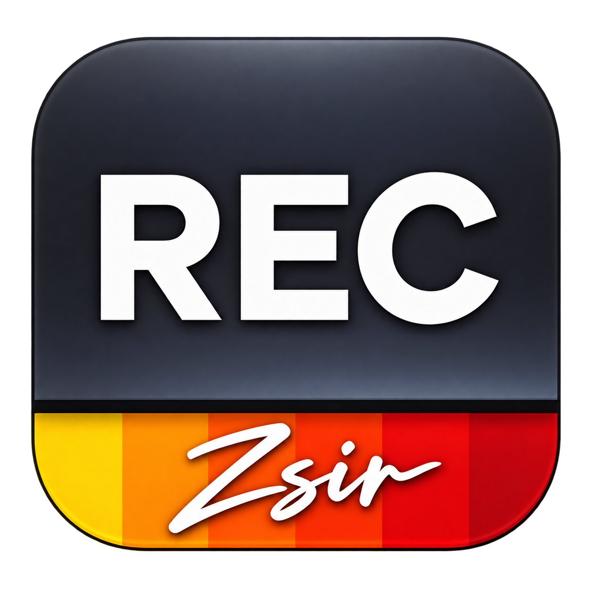

  
  <h1>庄Sir采访录制助手</h1>
  
<strong>把采访素材，高清留在嘉宾电脑里。</strong>

  
选择画面，点击录制。一个安静待在屏幕边缘的本地录制小工具。

  
<a href="https://github.com/billzhuang6569/zsir-interview-assistant/releases/tag/v0.3.0">下载 v0.3.0</a> · <a href="#三步开始录制">开始使用</a> · <a href="#能力与验证范围">支持范围</a> · <a href="docs/product.md">产品设计</a>

  

## 为采访留下两份独立素材

线上采访需要方便沟通，也需要给后期留下清晰的人物和演示画面。庄Sir采访录制助手在嘉宾本机采集和保存素材，让嘉宾自己确认画面、开始录制、停止保存。

| 素材 | 画面与声音 | 适合的内容 |
| --- | --- | --- |
| 嘉宾机位 · macOS | 摄像头 + 话筒 | 人物采访、表情与回答 |
| 桌面机位 · macOS / Windows | 显示器 + 系统播放声音 | 软件演示、课件、视频播放 |

macOS 可选择只录摄像头、只录桌面或同时录两路；Windows 当前提供桌面机位。桌面声音包含会议、演示及通知等系统播放声音，不主动混入话筒。素材保存到本机，无需账号，无需中转服务器，也不会自动上传。

## 录得清楚，也看得放心

- **实时确认画面**：小窗展示视频预览，可以折叠隐藏；macOS 支持摄像头、话筒和显示器选择，Windows 支持显示器和声音输出设备选择。
- **知道已经录了多久**：录制中显示时:分:秒，超过一小时继续累计。
- **把屏幕留给采访**：15 秒不操作小窗后，自动收起为屏幕边缘的小红圈；点击展开，录制继续。主窗口和红圈会从本工具的桌面录制中排除。
- **素材留在自己手里**：停止后在本地素材目录查看文件。遇到异常保留可用素材，macOS 可尝试生成恢复副本；恢复不保证找回尚未写入的数据。

## 下载

v0.3.0 新增Mac完整版自动版本检测、macOS13兼容、macOS12.3独立兼容包，以及Windows编码工具内置。六包同版本发布。

| 你的电脑 | 下载 | 要求与说明 |
| --- | --- | --- |
| Mac · M芯片 | [完整版 ARM64](https://github.com/billzhuang6569/zsir-interview-assistant/releases/download/v0.3.0/ZSirCapture-0.3.0-macos-arm64.zip) | macOS13+ |
| Mac · Intel | [完整版 Intel](https://github.com/billzhuang6569/zsir-interview-assistant/releases/download/v0.3.0/ZSirCapture-0.3.0-macos-x86_64.zip) | macOS13+ |
| 旧版Mac · M芯片 | [macOS12兼容版 ARM64](https://github.com/billzhuang6569/zsir-interview-assistant/releases/download/v0.3.0/ZSirCapture-0.3.0-macos12-arm64.zip) | macOS12.3+；桌面不含系统声音 |
| 旧版Mac · Intel | [macOS12兼容版 Intel](https://github.com/billzhuang6569/zsir-interview-assistant/releases/download/v0.3.0/ZSirCapture-0.3.0-macos12-x86_64.zip) | macOS12.3+；桌面不含系统声音 |
| Windows · Intel / AMD | [Windows x64](https://github.com/billzhuang6569/zsir-interview-assistant/releases/download/v0.3.0/ZSirCapture-0.3.0-windows-x64.zip) | Windows10 2004+；解压即用 |
| Windows · ARM | [Windows ARM64](https://github.com/billzhuang6569/zsir-interview-assistant/releases/download/v0.3.0/ZSirCapture-0.3.0-windows-arm64.zip) | Windows11 ARM；编码工具使用x64仿真 |

[发布说明](https://github.com/billzhuang6569/zsir-interview-assistant/releases/tag/v0.3.0) · [SHA256校验](https://github.com/billzhuang6569/zsir-interview-assistant/releases/download/v0.3.0/SHA256SUMS.txt) · [编码工具完整源码](https://github.com/billzhuang6569/zsir-interview-assistant/releases/download/v0.3.0/recording-tools-source.tar.gz)

Mac完整版在高级设置中提供自动/手动检查和自定义HTTPS清单来源；录制期间不打扰，仅提示下载，不自动安装。macOS12兼容版与Windows本轮不提供版本检测。v0.2.0用户需手动升级一次。

### 三步开始录制

**1. 打开应用。** Mac 解压后打开「庄Sir采访录制助手.app」，首次打开按引导选择「摄像头」「桌面」或「摄像头+桌面」，逐项允许所需权限，完成后进入录制小窗。拒绝过的权限可通过引导中的「打开系统设置」调整，返回后重新检查；也可稍后从录制设置中继续。Windows完整解压后直接打开 `ZSirCapture.Windows.exe`，保留tools和运行时文件；无需执行脚本或另装.NET。

**2. 选好设备，做一次试录。** 选择要录的画面、声音设备和保存位置，通过实时预览确认构图。说几句话、播放一段声音，停止后检查保存的视频。建议佩戴耳机，减少外放声音被话筒收进人物素材。

**3. 开始采访，结束后保存。** 点击开始录制，窗口闲置后自动收起。需要操作时点击边缘红圈展开，再点击停止并保存。默认素材目录为用户「影片／视频」中的 `ZSir Recordings`，可通过界面的素材目录入口打开。

Windows已内置编码工具，录制可离线进行。应用尚未取得发行签名，macOS 尚未公证；遇到安全提示时检查下载来源并遵循系统提示，不要关闭系统安全功能。

## 能力与验证范围

| 能力 | macOS | Windows |
| --- | --- | --- |
| 摄像头 + 话筒 | 支持 | 尚未实现 |
| 桌面 + 系统声音 | 完整版支持；macOS12兼容版仅画面 | 支持 |
| 双路独立素材 | 支持 | 当前仅桌面一路 |
| 实时预览、录制计时、边缘收起 | 支持 | 支持 |
| 异常素材处理 | 保留原文件，可生成恢复副本 | 保留分离视频和原始声音，尚无自动恢复界面 |

macOS Apple Silicon 与 Windows x64 已完成短录及相关自检。Mac Intel 已交叉编译并通过 Rosetta 下的界面、编码和恢复自检，尚未在 Intel 物理机器上验证采集。macOS12/13尚缺对应旧系统实机，已完成两架构构建与兼容路径检查。Windows ARM64已构建并核验架构，但物理ARM设备采集仍未验收。完整记录见[测试目录](docs/testing)。

**仍需验证**：1 小时以上采访、与会议软件共用设备、不同多屏与 DPI 设置、断电及磁盘故障、Final Cut Pro 导入。Windows 当前使用软件编码，并保留中间素材，会增加 CPU 与磁盘占用。录制前请留足空间；完成保存也不等于已经交付给剪辑师。

## 参与开发

产品目标是轻量、完全本地、嘉宾可自行操作。下一步优先验证长时间录制与异常恢复，再补齐 Windows 摄像头能力。欢迎提交附带复现步骤的 [Issue](https://github.com/billzhuang6569/zsir-interview-assistant/issues) 或聚焦单个问题的 PR；报告问题时请避免附上私人采访素材。

- [macOS 构建与自检](clients/macos/README.md) · [Windows 构建与实机测试](clients/windows/README.md)
- [产品需求](docs/product.md) · [开发设计](docs/development.md) · [验收计划](docs/validation.md)
- [界面设计](docs/design/README.md) · [技术调查](docs/research.md)

早期导演网页、远程控制与中转服务方案保留在[历史设计](docs/archive/remote-v0.2/product.md)和[模拟原型](prototype/README.md)中，不属于当前本地版功能。

## 开源许可

原创代码、文档与设计采用 [MIT](LICENSE) 许可证。Microsoft .NET 与 FFmpeg 使用各自的许可证；Windows 包保留 .NET 许可声明，FFmpeg/x264以独立进程随包分发，附GPL许可；Release提供完整对应源码与构建脚本。
