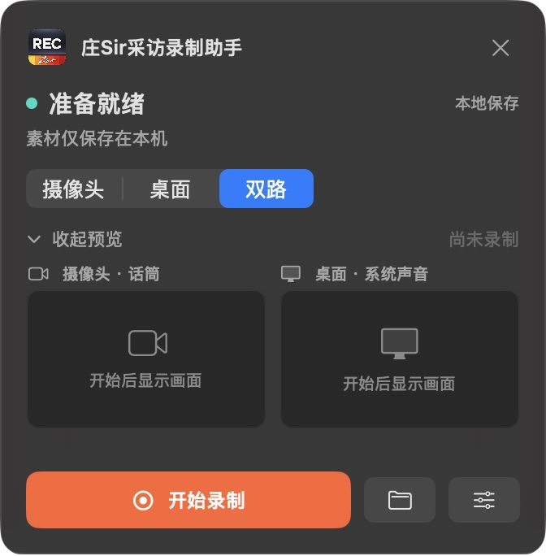
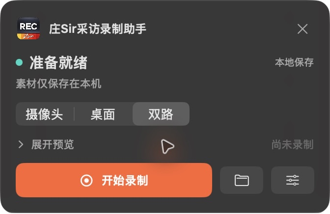
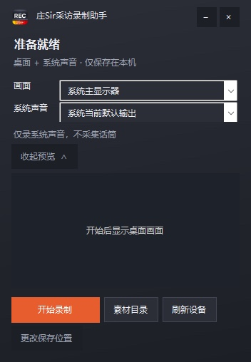
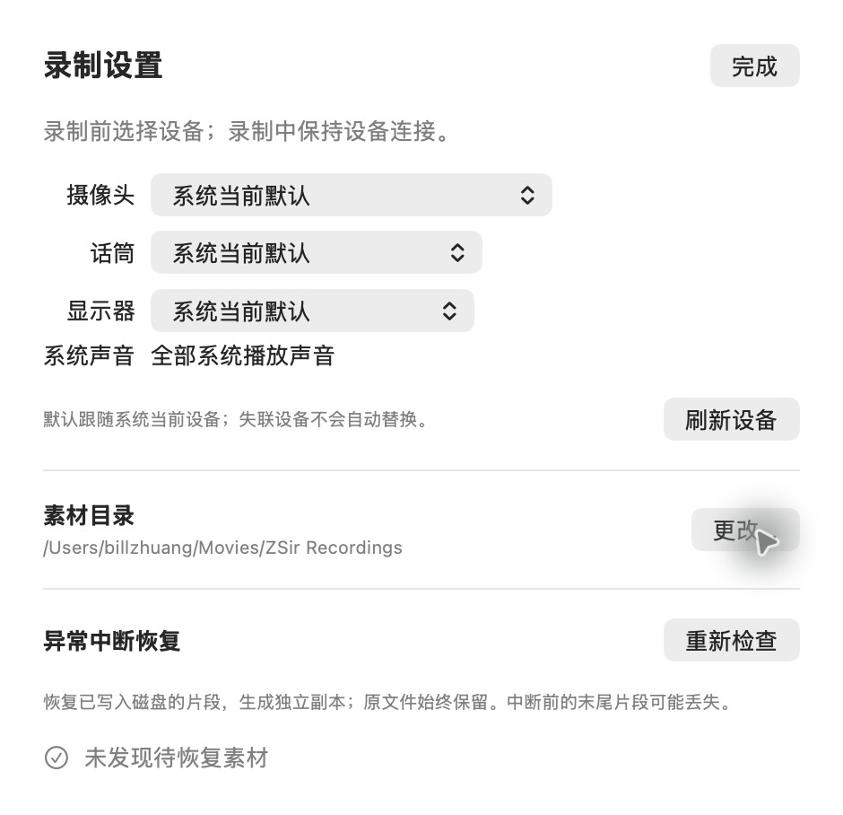
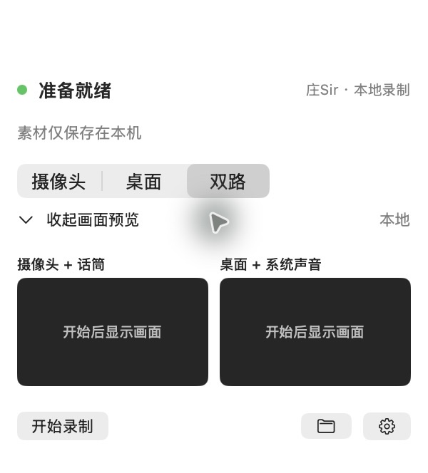
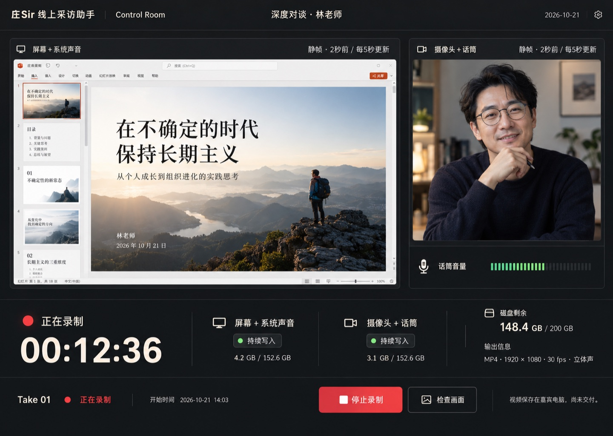
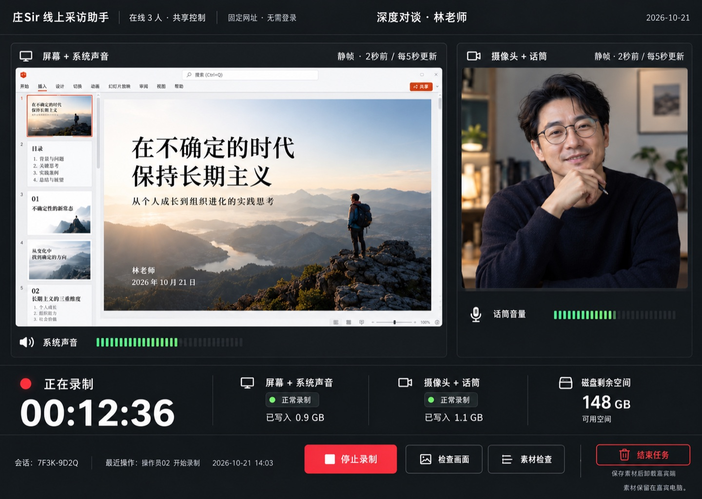

## macOS 暗色毛玻璃修订（2026-10-21）

统一使用“庄Sir采访录制助手”与 REC / Zsir 图标。小窗使用 NSVisualEffectView 原生背景模糊与暗色遮罩，保留暖橙录制按钮；内容高度驱动窗口尺寸，折叠和单/双路切换时顶部位置保持稳定。设置面板继承暗色外观。

## Windows 本地小窗（2026-10-21）

原生 WinForms 开发版，右上角显示桌面与系统声音的录制状态。直接选择显示器和播放设备，默认系统当前设备；开始/停止、素材目录入口和可折叠的同源连续预览均可用。录制和保存时锁定设备选择。此阶段仅桌面机位，不展示尚未实现的摄像头开关。

本轮更新：REC 图标底部加入白色手写 Zsir，名称统一为“庄Sir采访录制助手”。去掉旧式标题栏、固定高度空白，采用深灰渐变面板和暖橙主按钮，设备菜单深色显示。预览折叠后按内容缩短窗口；保存后明确显示上次画面。图标原稿与生成提示保留在 [Assets](../../clients/windows/Assets/README.md)。

## 本地设置面板（2026-10-21）

设备、目录和素材恢复放入独立设置面板，录制小窗继续保持紧凑。默认系统当前设备；列表支持手动刷新，已断开的指定设备明确提示重选。系统声音完整采集。

> 2026-10-21 范围变更：下文远程导演界面为历史设计。当前以 [本地产品设计](../product.md) 的机位选择、可折叠缩略图和本地开始/停止为准。

# 前端与交互设计

2026-10-21 / 已选择第2套 Control Room，补充需求修订中。使用 Product Design 流程生成三种独立导演端概念图；已新增[可交互前端原型](../../prototype/README.md)，导演与嘉宾小窗使用同浏览器共享模拟状态；尚无真实录制或卸载功能。

## 1. 设计目标

让导演一眼确认“选对机位、收到声音、确实写盘”；让嘉宾只需完成设备和权限设置，并随时本地停止。页面不包含云原片管理、剪辑、实时视频或其他未定义功能。

设计目标尺寸 1440×1024；实际图片由生成工具输出，属于视觉概念而非像素级实现规格。正文 14–16px 起，关键状态不只用颜色。两端共用状态语义，各平台保留原生权限和文件选择体验。

## 2. 视觉方向记录

以下按本轮展示顺序列出。PNG 为原始交付，JPG 为轻量预览。所有人物、设备数值和会话均为合成示意。

### 1

[原始 PNG](quiet-studio.png)。生成标识 quiet-studio；就绪状态，以两路等权画面为中心。

### 2

[原始 PNG](control-room.png)。生成标识 control-room；录制状态，以桌面检查与写入状态为中心。

### 3

[原始 PNG](guided-take.png)。生成标识 guided-take；准备状态，以流程和就绪清单为中心。

用户已明确选择第2套，保留炭黑工作台、左侧桌面大画面、右侧嘉宾画面布局。第1/3套仅作历史探索；本次补充多人协同、结束任务和极小嘉宾窗，不重新选择三套方向。

### 已知概念稿偏差

生成图用于布局选择，需求冲突以产品/交互规格为准：第二张未展示独立系统音量，磁盘数值仅为示意且表达不统一；第三张就绪状态不能用“画面正常”代替人的检查，仍需两路音量和实际规格；第一张需要在正式页补产品身份与会话连接入口。画面中的超大标题在实现时缩回工作台尺度。第二/三张出现的装饰性设置/头像不自动扩展账户或设置功能。

所有稿件都还缺少异常态及嘉宾端的完整高保真页面，不能宣称全流程视觉验收通过。选定视觉后按下文补齐，而非把生成图中的细节视为额外需求。

### 第2套补充需求修订稿

[原始 PNG](control-room-revised.png)。保留第2套布局，增加在线人数/共享控制、独立系统音量、最近操作与“结束任务”；无账号登录入口。此图仍为静态设计稿，极小嘉宾窗规格见下文。

## 3. 信息架构与页面规格

| 页面/区域 | 内容 | 主动作 | 退出/失败处理 |
| --- | --- | --- | --- |
| 导演会话入口 | 固定网址免登录入口、在线人数、会话名、邀请、嘉宾授权进度 | 创建会话/复制邀请 | 过期邀请重建；不显示旧授权可用 |
| 导演准备页 | 两路静帧、设备/实际格式、音量、就绪清单、机位勾选 | 开始录制 | 无选择/权限不足禁用并解释 |
| 导演倒计时 | 客户端确认的3→2→1、机位、连接状态 | 取消开始 | 远程断线或撤权则取消 |
| 导演录制页 | 两路静帧、新鲜度、写入、时长、空间 | 停止录制 | 失联以最后确认事实显示，不假报停止 |
| 导演保存页 | 每路收尾/校验进度 | 等待；失败时重试检查 | 不允许直接再开重叠Take |
| 导演素材检查 | Take列表、两机位切换、20帧分页、时间码、大小/音轨 | 查看下一页/放大 | 缺失帧保留错误位置 |
| 嘉宾首次设置 | 设备预览、音量、屏幕缩略图、目录、权限说明 | 试录10秒 | 拒绝权限有系统设置/重试 |
| 嘉宾配对授权 | 共享网址控制范围、任务名称、查看/控制/结束任务卸载授权 | 允许本次连接 | 拒绝仍可本地使用 |
| 嘉宾试录结果 | 本地播放样片、检查结果、声音确认 | 确认准备完成 | 重新选设备并重试 |
| 嘉宾录制小窗 | 状态、时长、两路健康 | 停止 / 结束任务 | 关闭仅收起；托盘可恢复 |
| 嘉宾完成/恢复 | 保存路径、每路状态、缺失/中断区间 | 打开目录/尝试恢复 | 原段保留，不提供误导成功标识 |

导演的输出目录动作是请求嘉宾确认打开本地目录，不是远程文件浏览器。嘉宾设置录制中锁定，不能在活动Take里改设备/目录。

## 4. 页面布局线框规格

### 导演工作台

- 顶部一行：产品身份、会话名、在线人数与共享控制、嘉宾连接/授权、最后确认时间。无头像、账号或登录入口。
- 主区域：摄像头/桌面预览，图像保持原比例，留黑边也不拉伸。每路附静帧年龄、来源、实际尺寸/帧率、独立音量和写入状态。
- 行动区：当前Take状态与计时、主开始/停止按钮、检查画面；其他操作放素材检查入口。
- 失联提示固定在主操作附近，不能靠 toast 一闪而过；异常机位清楚列出，正常路仍可检查。
- 素材页：Take选择、机位切换、分页宫格与详情；每张实际时间码，放大层支持键盘返回，不能用满屏无限长图。

### 嘉宾设置窗口

首次配置或主动展开时使用候选 760×620 窗口，可缩放；不是客户端常态界面，完成后收回右上角小窗。左侧预览与两路音量，右侧从上到下为摄像头、话筒、屏幕、系统输出和目录。权限问题紧贴对应控件；底部主要按钮“试录10秒”，随后“准备完成”。配对信息独立显示授权状态，不压过设备配置。

### 嘉宾悬浮窗

候选约240×88逻辑像素，右上角停靠，不显示大幅预览；状态与时长第一行，两路健康第二行，紧凑文字操作“停止/开始”“结束任务”和展开入口。必要时为系统字体缩放适当增高，不能以缩小字体牺牲可读性。详细音量只在展开层。菜单栏/托盘重复提供显示状态、打开窗口、停止和退出。误触关闭仅收起，退出活动录制需处理保存，不让用户因找不到窗口失去停止权。

### 录后页面

嘉宾侧明确路径与本地文件；导演侧明确“已保存在嘉宾电脑，尚未交付”。失败使用“相机已保存 / 桌面保存失败”这种逐路结论，不用一个全局绿色勾覆盖部分失败。

## 5. 状态文案契约

| 条件 | 文案 | 禁止误导 |
| --- | --- | --- |
| 有预览、没有录制 | 预览中，未录制 | 正在直播/已录制 |
| 已发开始但未确认 | 等待嘉宾端确认 | 正在录制 |
| 倒计时 | 3秒后开始，可取消 | 已录制3秒 |
| 编码写入已确认 | 正在录制 · 00:12:36 | 仅凭命令accepted显示 |
| 画面超10秒 | 画面已过期 · 最后更新于… | 刚刚更新 |
| 连接断开 | 连接中断，状态待确认；最后确认正在录制 | 录制已停止 |
| 停止已发送 | 正在保存，请勿退出 | 已保存 |
| 全部文件校验完成 | 已保存在嘉宾电脑，尚未交付 | 导演已收到素材 |
| 一路失败 | 部分素材已保存 · 桌面机位失败 | 保存成功 |
| 授权撤销且仍录制 | 已断开导演，本地仍在录制 | 已停止录制 |

## 6. 可访问性、响应式与交互

所有主要操作有可见文字和键盘焦点。表单使用显式标签，音量条有文本状态；红绿状态同时有文字/图标。错误播报优先于普通进度，计时不每秒打断读屏。预览图片的替代文字描述机位与更新时间，不臆测画面内容。

主按钮触控目标至少 44px；正常文字对比目标4.5:1；尊重减少动画偏好，红点不频闪。确认层关闭后恢复焦点，Escape只关闭放大图/弹层，不停止录制。空格不能在页面任意位置触发停止。

桌面≥1200px采用选定双路布局；768–1199px收紧侧栏；<768px纵向堆叠，停止/状态始终可达但不遮住正文。移动网页是应急查看/控制，不承诺完整小字验片。嘉宾小窗须测试不同系统缩放与屏幕边缘位置。

## 7. 后续实现与评审

第2套已选定；补充需求修订稿展示后沿该方向初始化前端原型，先实现 mock 状态的核心闭环并显著标“交互演示，未连接录制引擎”。导航、机位选择、倒计时取消、停止保存、失联提示、宫格分页与放大必须可操作；未连原生功能不能显示为真实录制成功。

前端验收包括1440px桌面、1024px缩放布局、390px窄屏、200%缩放、全键盘操作、正常/断线/保存失败/部分失败状态；与选定图同视口比对并修正偏差。最终再连接真实协议与实机验证。

## 8. 多人共控与结束任务交互

固定网址直接呈现工作台，无注册或登录流程。顶部“在线3人 · 共享控制”，匿名来源只用于最近操作提示。所有网页同步机位勾选、倒计时、Take状态、静帧和结束进度。其他人操作时显示来源及结果，不强制刷新、不出现主控接管弹窗。

“结束任务”在导演页操作栏右侧单独放置，与红色“停止录制”拉开距离；嘉宾极小窗同样有文字按钮。两端使用同一确认文案：“结束本次采访？将停止采集并保存素材，清理并卸载嘉宾客户端。已录视频保留在嘉宾电脑。”按钮为“返回”“结束并卸载”。这是破坏性产品动作的确认，不是账号验证；不额外加导演登录或嘉宾重复审批。

结束后所有网页只读，依次显示停止采集、保存素材、授权已撤销、卸载进度与结果。失败不能被成功动画掩盖；权限阻止时显示“采集已关闭，需要嘉宾完成系统卸载确认”。离线显示“未送达，未确认停止或卸载”。固定网址仍可访问空控制台，但原任务不可恢复控制。

小窗中的“关闭/收起”“停止录制”“结束任务”必须有不同语义；展开设置不改变当前录制，退出程序不是卸载。客户端极小窗须同时验证macOS/Windows不同缩放及触控目标，240×88为布局目标而非不可变像素限制。
