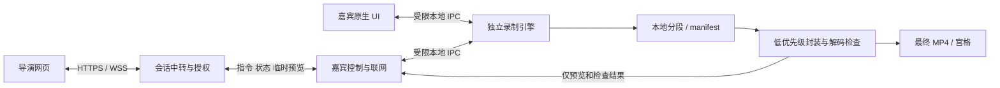
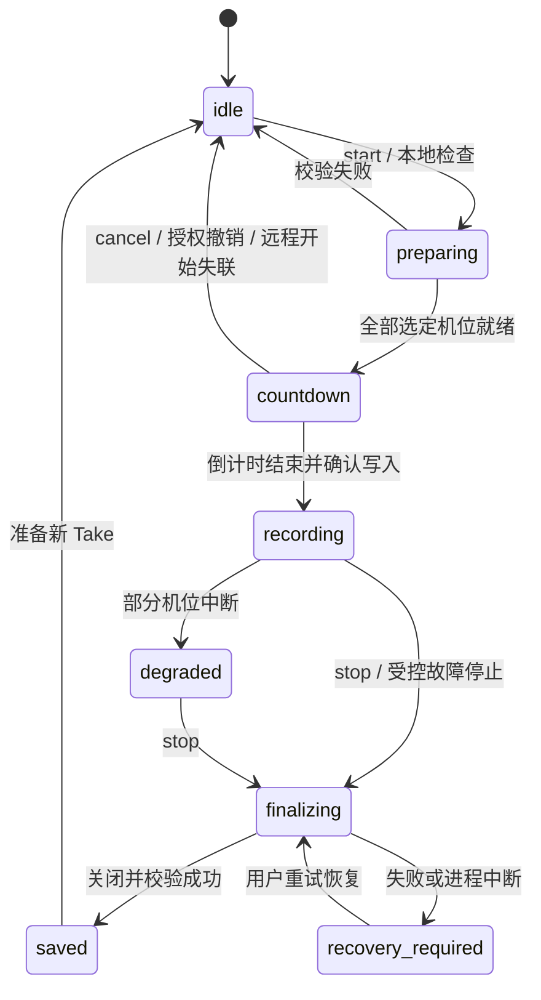

# 开发设计

版本：0.1 / 2026-10-21。本文定义拟实现的行为与边界，所有 API 均为设计草案；仓库尚无对应实现。

## 1. 架构与职责



引擎是活动 Take 的唯一写入者与事实来源。UI、网络和图片生成不能阻塞媒体线程。媒体队列有上限；预览队列只保留最新任务，满载先丢预览，不无界累积帧。独立进程崩溃仍可能影响设备，应验证而非仅凭进程隔离宣称可靠。

| 模块 | 输入 | 输出 | 不承担 |
| --- | --- | --- | --- |
| 平台采集适配 | 本地选定设备、权限、参数 | 带本地时间戳的视频/音频样本 | 网络、业务授权 |
| 录制引擎 | 经验证命令与采集数据 | 状态、分段、写入指标 | UI 与云供应商逻辑 |
| 嘉宾 UI/连接层 | 用户动作、会话命令 | 本地请求、授权状态 | 写文件生命周期 |
| 中转 | 已授权消息 | 定向转发、短期状态缓存 | 宣布录制成功、访问本机路径 |
| 后处理 | 已关闭的分段/文件 | MP4、校验报告、宫格 | 修改原始采集内容 |
| 导演网页 | 客户端状态、静帧 | 命令意图与可见反馈 | 猜测实际录制状态 |

未来目录建议为 clients/macos、clients/windows、web、service、protocol；当前只创建文档与设计资产，不生成空工程、空测试或未用依赖。平台实现确定后再创建对应目录。

## 2. 状态模型

网络连接、授权和录制是三个独立维度，断网不等于停止。



- 只有所有选定机位就绪才倒计时。启动时部分写入成功而另一失败：停止已启动部分并保留样本，记录 `start_failed`，不显示正常录制。
- 本地开始不依赖网络；远程开始若在倒计时阶段失去会话/授权则取消。已经 `recording` 后断网继续。
- 每机位另有 `not_selected / preparing / writing / interrupted / finalized / failed`。一机位失败不伪装全成功；Take 的 `saved` 可携带 `partial` 结果，UI 必须显示“部分素材已保存”。
- UI 崩溃不改变引擎状态。引擎重启不自动继续旧 Take 采集；先恢复已有段，用户明确开启下一条。
- `unknown` 是导演对远程事实的观察状态，不写入本地录制状态机。失联显示最后确认事实及时间。
- 暂停暂未进入该状态机；若决定纳入，需要显式 paused、暂停区间与双路统一时间映射。

## 3. 会话与命令协议草案 v1

### 配对与授权

导演经服务认证后创建会话；嘉宾用短期一次性配对入口申请加入。嘉宾确认导演身份和权限范围后签发受限会话凭据。配对码候选有效期 10 分钟，服务按 IP/会话限速，失败次数过多失效；具体阈值上线前压测。配对码不是永久身份凭据。

会话凭据只能访问自己的 session 和 participant；导演只能控制当前已授权嘉宾。撤销时更新 authorizationEpoch、失效旧凭据并清除预览。客户端在执行命令与上传图片前复核 epoch，不能只靠服务过滤。网络分区无法保证远程即时撤权，UI 如实显示撤销待确认；嘉宾本地撤销立即生效。

### 命令信封

```json
{
  "protocolVersion": 1,
  "sessionId": "session_demo",
  "participantId": "guest_demo",
  "commandId": "unique-command-id",
  "authorizationEpoch": 3,
  "type": "start",
  "issuedAt": "2026-10-21T06:00:00Z",
  "expiresAt": "2026-10-21T06:00:15Z",
  "expectedStateVersion": 12,
  "takeId": "take_demo_01",
  "payload": { "tracks": ["camera", "desktop"], "countdownSeconds": 3 }
}
```

示例 ID 无任何真实凭据。`takeId` 为不透明 ID，不允许用它拼接不校验的任意路径。`expectedStateVersion` 防止基于旧状态误操作；每次状态变化单调递增，命令处理在引擎内串行化。

| type | 前置条件 | 成功结果 |
| --- | --- | --- |
| inspect | 有当前查看权限、可采集 | 返回各机位静帧或明确失败 |
| start | idle、授权有效、至少一机位、目录/磁盘就绪 | accepted → countdown → recording 或失败 |
| cancel_start | 对应 Take 正在 preparing/countdown | 取消后 idle |
| stop | 指定 Take 活动或已结束 | 活动则 finalizing；已结束返回原结果 |
| get_state | 可查询会话 | 返回引擎当前快照与未完成命令 |
| generate_contact_sheet | 指定已保存本地素材且有检查权限 | jobId，按路分页结果 |
| request_open_output | 对当前 Take 有权限 | 客户端提示确认；只打开已登记目录 |

没有远程任意命令执行、任意路径、任意 URL 下载、删除素材或更换采集设备的接口。

### 幂等、过期与确认

1. 验证版本、字段类型/长度、会话、角色、授权与有效期，再处理命令。拒绝未知类型、非法机位、未来过远/已过期时间戳。服务器校时只用于 TTL，不用于媒体时间轴；允许偏差阈值候选 5 秒，超限要求重新握手。
2. 在本地持久记录 commandId、参数摘要和结果；相同 ID 相同参数返回已有结果，同 ID 不同参数拒绝。start 的 Take 记录必须在采集副作用前持久化；恢复时先核对日志与文件，不能盲重放。
3. `accepted` 仅表示接受意图；`recording` 必须在选定管线均有编码数据写入后发送。存活心跳不是持续写盘证据，另报 bytesWritten、lastWriteAt 与错误。
4. 默认命令 TTL 候选 15 秒（不限制已接受的收尾任务执行时长）；过期不执行。停止命令过期/结果不明时，先查询指定 Take，用户确认后发新的停止意图。
5. 本地操作和远程命令共用串行状态机。本地停止后迟到 start 不得启动新 Take；状态版本不匹配返回 conflict 与快照。stop 只针对明确 Take，绝不停止后来新开的 Take。
6. 重连先认证、查询快照、核对未完成 commandId，再更新界面；不队列重放旧 start。去重日志至少覆盖会话与恢复周期；清理后仍靠过期/Take 唯一性拒绝旧命令。

错误码候选：permission_denied、device_busy、device_missing、disk_low、path_unwritable、expired_command、state_conflict、unsupported_version、encoder_failed、finalize_failed。给用户本地化文案，日志不记录 token 或帧内容。

## 4. 状态与预览传输

状态快照包括 sessionId、takeId、stateVersion、engineInstanceId、recordingState、每路状态/媒体时长/实际格式/字节增量/最近写入时间、剩余空间、错误码。重启通过 engineInstanceId 区分版本序列，网页拒绝旧实例延迟消息覆盖新快照。

候选心跳 2 秒，超过 6 秒未收到标记连接待确认；预览每路 5 秒目标更新，超过 10 秒标过期。计时器从本地单调媒体时钟派生；网页插值只能标“估算”，断线冻结最后确认时长。

图片附带 track、takeId、capture timestamp、sequence、尺寸、MIME 和大小；根据 sequence 丢弃乱序旧图。默认约 960px 宽 JPEG 候选，高清检查临时提高；最终参数根据带宽和辨识度调优。上传限制候选单图 2MB、限制总像素并解码验证，防伪装 MIME/解压炸弹。接收端展示服务生成的受限资源标识，拒绝任意外部图片 URL。

实时预览采用只保留最新帧的中转，断线不补发历史队列。宫格按需分页生成并有进度、限流、取消和重试。临时存储不公开，授权校验先于下载；候选最多保存 24 小时，会话结束/撤销后删除对象并立即停止授权访问，物理清理重试最长 24 小时。访问链接短时有效且不写日志；无须对象存储时优先直接中转。

## 5. 本地素材生命周期

```text
<用户目录>/<日期>_<安全会话名>/<take-id>/
  manifest.json
  camera/segments/...
  desktop/segments/...
  camera.mp4
  desktop.mp4
  checks.json
  contact-sheets/...
```

目录中的用户可见名称需规范化，不允许 `..`、绝对路径、设备名或符号链接越出授权根。文件以独占创建避免覆盖，同名 Take 不复用已有目录。网络协议只使用 ID，本机绝对路径不上传。

manifest 至少记录：schemaVersion、Take/机位 ID、实际格式、采集开始相对单调时间、音视频时基、分段顺序/起止/大小、完成标志、中断、错误、最终文件检查结果。写临时 manifest 后原子替换，段关闭并提交后才标完成。具体 fsync 与封装策略在故障实验中确定。

录制内部候选短分段或 fragmented MP4，分段时长候选 5–10 秒；必须测量断电丢失上界，不承诺固定“最多丢 5 秒”。停止后无损重封装成常规 MP4，写临时目标，验证后原子改名。校验最终文件前绝不删除原始段；首版原始段清理由嘉宾明确操作，不能后台擅自清空。

校验至少包含：文件可读、容器可解析、预期视频与音轨存在、首尾可解码、时长合理、分段时间戳连续/间断明确。完整解码检查可作为低优先级任务，但首尾抽查不能叫“整片完整验证”。

磁盘预算：当前剩余可写空间减去收尾预算与安全余量。重封装可能需要再写一份总素材，预算须按全部已录片段大小增长；候选安全余量 max(2GB, 5分钟峰值写入量)。低于预算时停止接收新采集并收尾/保留分段，不能等到写盘失败再猜。

两路使用统一单调时基，重采样处理音频设备时钟漂移，记录真实启动差与中断。不能仅凭两路开始按钮时间相同就声称同步。

## 6. 本机 IPC 与安全

本机控制通道仅同用户身份可连接，使用受限 named pipe / Unix socket 或平台等效机制；权限和 peer 身份校验不可省略。仅允许枚举过的动作，不开放通用 shell。路径操作由引擎从内部 Take 映射解析。

网页、服务和客户端均做 schema 校验与资源上限。HTTPS/WSS、凭据安全存储、浏览器安全 cookie/CSRF 与 Origin 检查按最终认证方式落实。连接凭据不放查询字符串；邀请码使用后立即作废。依赖更新、签名/公证/安装信任必须在发布阶段验证。

公开仓库不提交原片、真实嘉宾截图、访问日志、目录、令牌、证书私钥或生产配置。所有文档图均为合成示意。诊断只记录版本、错误码、匿名会话关联与耗时，不默认记录设备序列号或媒体内容。

## 7. 开发顺序与变更规则

先完成[验收计划](validation.md) P0，再冻结平台版本、工具链和协议 schema。每个非平凡状态规则须有小而真实的单元测试；设备和编码可靠性必须用集成/实机测试补足。文档当前不提供虚构的构建/运行命令。

修改协议需同步更新客户端两个适配、服务校验、网页状态、协议样例、故障用例与兼容策略。修改媒体默认值需更新磁盘预算、试录、后期样片和支持矩阵。修改状态文案需检查双端、失联态、可访问性播报与设计规格。
